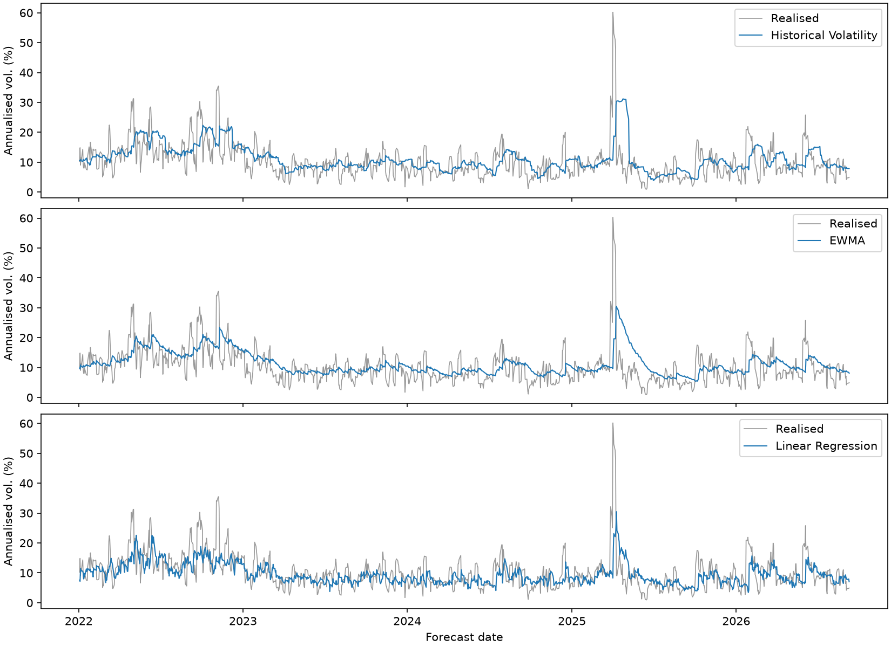
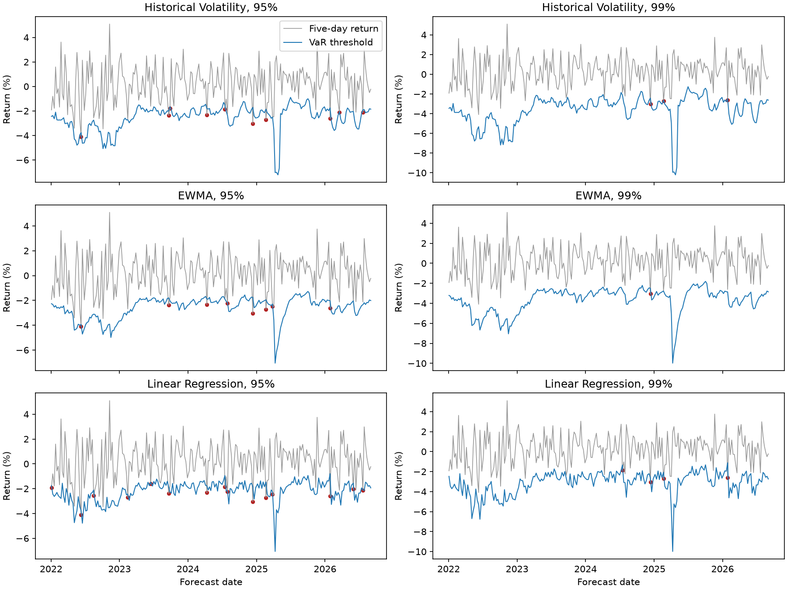

# Portfolio Risk Forecasting

## Question

Does a lower error in forecasting portfolio volatility lead to more reliable five-day Value at Risk (VaR)? This project compares simple volatility forecasts with three regression methods, then checks the resulting 95% and 99% VaR limits on the same fixed test period.

## Data and portfolio

Seven Yahoo Finance adjusted-close series (SPY, QQQ, IWM, TLT, HYG, GLD and DBC) run from **2010-01-04 to 2026-09-16**: 4,201 aligned XNYS trading dates and 4,200 daily return dates. The script requires every expected session and a positive adjusted price for every asset. It neither fills missing prices nor removes unexplained gaps. The local snapshot was downloaded on 2026-09-19; it is not distributed with the repository. A fresh Yahoo download may yield revised values. See [data provenance](data/README.md).

The portfolio holds 1/7 in each ETF at each daily close. Daily portfolio return is the mean of the seven adjusted-price returns; this represents daily rebalancing and preserves cross-asset co-movement.

## Forecast design

All eight features at forecast date `t` use returns through `t`:

| Feature | Definition |
| --- | --- |
| `return_1d` | Portfolio return on `t` |
| `return_5d`, `return_20d` | Compounded portfolio returns over the last 5 or 20 sessions |
| `volatility_5d`, `volatility_20d`, `volatility_60d` | Trailing sample standard deviation, annualised by √252 |
| `drawdown` | Compounded portfolio wealth relative to its highest level since the sample start (including initial wealth of 1) |
| `average_correlation_20d` | Mean of the 21 distinct pairwise ETF return correlations over 20 sessions |

The target is the **sample standard deviation of portfolio returns from `t+1` through `t+5`, multiplied by √252**. It is a noisy volatility proxy because each estimate uses only five returns. The complete dataset has 4,136 forecast dates, from 2010-03-31 to 2026-09-09. The initial 59 dates lack a complete 60-day feature; the final five lack a complete target. These are the only rows omitted.

Initial training ends on 2017-12-21 (1,948 rows), validation runs from 2018-01-02 to 2021-12-23 (1,003), and test runs from 2022-01-03 to 2026-09-09 (1,175). For model selection, five dates before each boundary are excluded because their future five-day labels cross into the next period. After selection, the chosen model is refitted on every pre-test record whose label ends before the test period begins, including records previously excluded only at the training/validation boundary.

Historical Volatility uses the trailing 20-day feature. EWMA uses a 0.94 decay on squared daily portfolio returns, beginning with the first available return. Linear Regression, Random Forest (200 trees, depth 3, minimum leaf 10) and XGBoost (200 trees, depth 2, learning rate 0.03) use the same eight features and training labels. These are deliberately modest specifications. Historical Volatility and EWMA use their own fixed rules and no fitted target labels. All forecasts and targets are in annualised volatility decimals. Validation MAE selects the ML method; RMSE breaks a tie. The two baselines and the selected ML method are then compared on test. The tree methods are retained as nonlinear validation comparisons; they do not add a separate test claim.

## Volatility results

| Model | Validation MAE | Validation RMSE | Test MAE | Test RMSE |
| --- | ---: | ---: | ---: | ---: |
| Linear Regression | 0.035246 | 0.056723 | 0.035502 | 0.052967 |
| XGBoost | 0.035950 | 0.061745 | — | — |
| Random Forest | 0.037528 | 0.064782 | — | — |
| Historical Volatility | 0.041307 | 0.063688 | 0.040831 | 0.060382 |
| EWMA | 0.041399 | 0.061941 | 0.039416 | 0.057162 |

Linear Regression has the lowest validation MAE and the lowest test MAE and RMSE among the evaluated models. Its test RMSE is 7.34% below EWMA, the stronger baseline by RMSE. This point comparison does not establish statistical superiority or show that its VaR is more reliable.



## Five-day VaR

For each forecast, the positive loss limit is `z × annualised volatility × √(5/252)`, with normal quantiles 1.64485 at 95% and 2.32635 at 99%. Zero expected return, normality and square-root-of-time scaling are assumptions of this VaR calculation; the backtest does not verify them. A violation occurs when the **compounded** return over `t+1` through `t+5` is below the negative limit. Using a normal additive-return approximation for a compounded outcome is another limitation.

Kupiec's unconditional coverage test uses every fifth test forecast from 2022-01-03, giving 235 disjoint five-session outcomes per model and confidence level. The reported p-values use the one-degree-of-freedom chi-square reference distribution.

| Model | VaR | Violations / 235 | Rate | Kupiec LR | p-value |
| --- | ---: | ---: | ---: | ---: | ---: |
| Historical Volatility | 95% | 10 | 4.26% | 0.2883 | 0.5913 |
| Historical Volatility | 99% | 3 | 1.28% | 0.1670 | 0.6828 |
| EWMA | 95% | 8 | 3.40% | 1.4121 | 0.2347 |
| EWMA | 99% | 1 | 0.43% | 0.9990 | 0.3176 |
| Linear Regression | 95% | 15 | 6.38% | 0.8735 | 0.3500 |
| Linear Regression | 99% | 4 | 1.70% | 0.9668 | 0.3255 |

All six Kupiec p-values exceed 0.05, but non-rejection does **not** prove correct VaR calibration. At 95%, 11.75 violations are expected: Linear Regression's 15/235 is slightly closer to that count than EWMA's 8/235, despite having more breaches. At 99%, only 2.35 are expected, and Kupiec tests frequency rather than independence or loss severity. Lower volatility RMSE therefore cannot by itself establish better VaR. The distribution assumption, time scaling and noisy target may matter; this analysis does not identify a specific cause.

### Window-start sensitivity

The main result above keeps offset 0. As a diagnostic, the same saved forecasts were tested using four other starts, each followed by every fifth forecast. Each row has 235 disjoint five-session outcomes. Entries show violations, rate and Kupiec p-value; the full results are in [`var_window_sensitivity.csv`](outputs/tables/var_window_sensitivity.csv).

| Offset | Model | 95%: breaches (rate), p | 99%: breaches (rate), p |
| ---: | --- | ---: | ---: |
| 0 | Historical Volatility | 10/235 (4.26%), 0.5913 | 3/235 (1.28%), 0.6828 |
| 0 | EWMA | 8/235 (3.40%), 0.2347 | 1/235 (0.43%), 0.3176 |
| 0 | Linear Regression | 15/235 (6.38%), 0.3500 | 4/235 (1.70%), 0.3255 |
| 1 | Historical Volatility | 12/235 (5.11%), 0.9406 | 5/235 (2.13%), 0.1310 |
| 1 | EWMA | 10/235 (4.26%), 0.5913 | 6/235 (2.55%), 0.0453 |
| 1 | Linear Regression | 15/235 (6.38%), 0.3500 | 7/235 (2.98%), 0.0137 |
| 2 | Historical Volatility | 12/235 (5.11%), 0.9406 | 7/235 (2.98%), 0.0137 |
| 2 | EWMA | 11/235 (4.68%), 0.8206 | 5/235 (2.13%), 0.1310 |
| 2 | Linear Regression | 19/235 (8.09%), 0.0455 | 7/235 (2.98%), 0.0137 |
| 3 | Historical Volatility | 15/235 (6.38%), 0.3500 | 5/235 (2.13%), 0.1310 |
| 3 | EWMA | 15/235 (6.38%), 0.3500 | 2/235 (0.85%), 0.8138 |
| 3 | Linear Regression | 23/235 (9.79%), 0.0027 | 10/235 (4.26%), 0.0002 |
| 4 | Historical Volatility | 13/235 (5.53%), 0.7128 | 5/235 (2.13%), 0.1310 |
| 4 | EWMA | 12/235 (5.11%), 0.9406 | 6/235 (2.55%), 0.0453 |
| 4 | Linear Regression | 21/235 (8.94%), 0.0122 | 10/235 (4.26%), 0.0002 |

Some alternative starts give nominal p-values below 0.05, so the main non-rejection depends on the window start. Outcomes from different starts overlap and are not five independent backtests. Offset 0 remains the original main backtest convention; no start was chosen for a favourable result.



## Reproduce

Use Python 3.14 and run from the repository root:

```bash
python -m pip install -r requirements.txt
python analysis.py
python -m unittest discover -s tests -v
```

The script reads the checksum-verified local raw snapshot when available; otherwise it downloads the same fixed date range. It writes aggregate metrics to `outputs/tables`, the two figures to `outputs/figures`, and observation-level intermediate data locally under `data/processed` and ignored output paths. Exact published numbers require the original data vintage and dependency versions.

The fixed test period and its results have been inspected in earlier project iterations; it should not be presented as a pristine, once-only holdout. One split, seven ETFs, daily rebalancing without costs, a noisy five-return target and low power at 99% limit generalisation.
